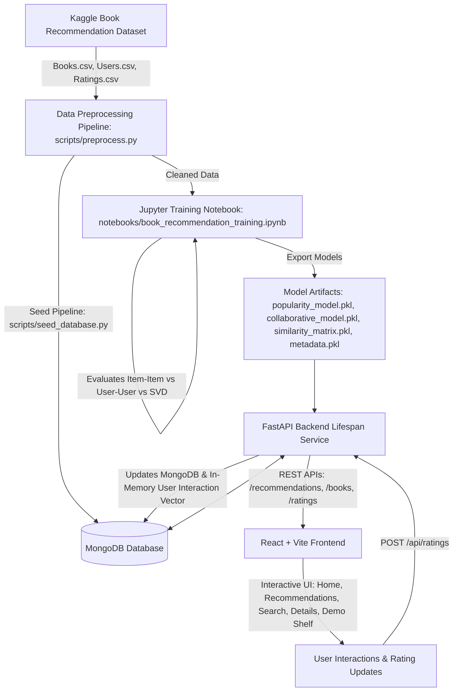

# Book reccomender

A production-style, end-to-end **Hybrid Book Recommendation System** that combines **Empirical Popularity-Based Ranking** and **Item-Based Collaborative Filtering** to deliver personalized book recommendations.

Built with **React 18 + Vite**, **Python FastAPI**, **MongoDB**, **Pandas**, **NumPy**, **Scikit-Learn**, and **SciPy**.

---

## Architecture Overview



---

## Key Features

- **Hybrid Recommendation Architecture**: Blends Item-Based Collaborative Filtering with Weighted Popularity Ranking ($w_{\text{CF}} = 0.7$, $w_{\text{pop}} = 0.3$).
- **Empirical Popularity Model**: Uses Bayesian weighted rating formula with minimum threshold $m$ derived statistically from dataset distribution.
- **Item-Based Collaborative Filtering**: Computes cosine similarity across user-item interaction sparse matrices with a popularity fallback for readers with limited history.
- **Incremental Rating Updates**: Rating a book instantly updates MongoDB and the user's active interaction profile in memory without needing full offline retraining.
- **Rigorous Evaluation Benchmark**: Candidate models (Item-Item Cosine, User-User Cosine, SVD Matrix Factorization) evaluated on a non-leaking per-user split using **Precision@K**, **Recall@K**, **MAP@K**, and **NDCG@K**.
- **Interactive Y2K Discovery UI**: React + Vite + Tailwind CSS frontend featuring active demo persona switching, live book search, interactive rating modal, and item similarity recommendations.

---

## ML Approach & Model Strategy

### 1. Popularity-Based Recommendation Model
To provide baseline ranking for readers with limited history, the popularity model uses the weighted rating formula:

$$W = \left(\frac{v}{v + m}\right) R + \left(\frac{m}{v + m}\right) C$$

- $R$: Average rating of the book
- $v$: Rating count of the book
- $C$: Global mean rating across the entire dataset ($C \approx 6.73$)
- $m$: Minimum rating threshold derived empirically from the 75th percentile of rating counts ($m = 12.0$)

### 2. Item-Based Collaborative Filtering
Candidate recommendation algorithms were benchmarked on a per-user train/test split:
- **Item-Item Cosine Similarity** (Selected Production Engine)
- **User-User Cosine Similarity**
- **SVD Matrix Factorization (Truncated SVD)**

Item-Item Cosine Similarity was selected because item-item relationships are significantly more stable than user-user profiles, less memory-intensive, and enable instant computation of predicted item similarity scores:

$$\text{Score}(b) = \frac{\sum_{i \in I_u} S_{b, i} \cdot R_i}{\sum_{i \in I_u} |S_{b, i}|}$$

### 3. Normalized Weighted Hybrid Score
For users with interaction history, candidate item scores are Min-Max normalized to $[0, 1]$ before applying configurable weights:

$$\text{Hybrid Score} = w_{\text{CF}} \cdot \hat{S}_{\text{CF}} + w_{\text{pop}} \cdot \hat{S}_{\text{pop}}$$

Default weights: $w_{\text{CF}} = 0.7$, $w_{\text{pop}} = 0.3$ (configurable via environment variables or UI sliders).

---

## Quantitative Benchmark & Evaluation

All candidate algorithms were evaluated on a **per-user 80/20 train/test split** to prevent data leakage across user interactions.

| Recommendation Algorithm | Precision@10 | Recall@10 | MAP@10 | NDCG@10 |
| :--- | :---: | :---: | :---: | :---: |
| **Item-Item Cosine Similarity (Selected)** | **0.0530** | **0.1712** | **0.0551** | **0.1074** |
| **User-User Cosine Similarity** | 0.0508 | 0.1592 | 0.0516 | 0.1006 |
| **SVD Matrix Factorization** | 0.0034 | 0.0153 | 0.0054 | 0.0095 |

*Item-Item Cosine Similarity achieved the highest NDCG@10 and MAP@10 scores, confirming its superior suitability for sparse interaction dataset recommendation.*

---

## Project Structure

```
book-recommendation-system/
├── README.md
├── .gitignore
├── .env.example
├── data/
│   ├── raw/                 # Books.csv, Users.csv, Ratings.csv (Gitignored)
│   └── processed/           # cleaned_books.csv, cleaned_users.csv, cleaned_ratings.csv
├── notebooks/
│   └── book_recommendation_training.ipynb  # ML/Research Source of Truth
├── backend/
│   ├── app/
│   │   ├── main.py          # FastAPI startup & CORS configuration
│   │   ├── config.py        # Pydantic BaseSettings
│   │   ├── api/             # Health, Books, Recommendations, Ratings, Users routers
│   │   ├── database/        # Async Motor/PyMongo connection manager
│   │   ├── models/          # Pydantic request/response schemas
│   │   └── services/        # Popularity, Collaborative, Hybrid, & Coordinator services
│   ├── artifacts/           # Model binaries (popularity_model.pkl, collaborative_model.pkl, etc.)
│   ├── tests/               # Pytest suite
│   └── requirements.txt     # Python backend dependencies
├── scripts/
│   ├── download_data.py     # Dataset downloader & fallback generator
│   ├── preprocess.py        # Data cleaning & empirical statistics script
│   ├── train.py             # Reproducible training & artifact generation script
│   ├── seed_database.py     # Bulk MongoDB loader & index creation
│   └── verify_pipeline.py   # End-to-end verification script
└── frontend/
    ├── package.json
    ├── vite.config.js
    ├── tailwind.config.js
    └── src/
        ├── components/      # Navbar, BookCard, RatingModal, Footer
        ├── context/         # UserContext for demo persona management
        ├── pages/           # HomePage, RecommendationsPage, SearchPage, BookDetailPage, UserShelfPage
        └── services/        # Axios API client wrapper
```

---

## Quickstart Setup Guide

### 1. Prerequisites
- **Python**: 3.10+ (Tested on Python 3.12)
- **Node.js**: v18+ & `npm`
- **MongoDB**: Local MongoDB instance running on `mongodb://localhost:27017`

### 2. Clone Repository & Setup Virtual Environment
```bash
git clone https://github.com/your-username/book-recommendation-system.git
cd book-recommendation-system

# Create and activate Python virtual environment
python -m venv .venv
# On Windows:
.venv\Scripts\activate
# On Linux/macOS:
source .venv/bin/activate

# Install backend dependencies
pip install -r backend/requirements.txt
```

### 3. Environment Configuration
Copy `.env.example` to `.env`:
```bash
cp .env.example .env
```
Default `.env` contents:
```env
MONGODB_URI=mongodb://localhost:27017
DATABASE_NAME=book_recommender
FRONTEND_URL=http://localhost:5173
CF_WEIGHT=0.7
POPULARITY_WEIGHT=0.3
MODEL_ARTIFACTS_DIR=backend/artifacts
```

### 4. Data Preparation & Model Training Pipeline
Execute the end-to-end data preparation and ML training pipeline:

```bash
# Step A: Fetch or generate dataset
python scripts/download_data.py

# Step B: Run data cleaning & preprocessing
python scripts/preprocess.py

# Step C: Train recommendation models & export artifacts
python scripts/train.py

# Step D: Seed MongoDB database & build indexes
python scripts/seed_database.py

# Step E: Verify full pipeline & backend tests
python scripts/verify_pipeline.py
pytest backend/tests
```

---

## REST API Endpoints

| Method | Endpoint | Description |
| :--- | :--- | :--- |
| `GET` | `/api/health` | Backend status, MongoDB connection, & model load state |
| `GET` | `/api/recommendations/popular` | Top popularity-ranked books (Weighted Rating Score) |
| `GET` | `/api/recommendations/user/{user_id}` | Collaborative filtering recommendations |
| `GET` | `/api/recommendations/hybrid/{user_id}` | Normalized weighted hybrid recommendations |
| `GET` | `/api/books/search?q={query}` | Search catalogue by title, author, or ISBN |
| `GET` | `/api/books/{isbn}` | Get book details by ISBN |
| `GET` | `/api/books/{isbn}/similar` | Item similarity recommendations ("You May Also Like") |
| `POST` | `/api/ratings` | Submit user rating (updates MongoDB & in-memory vector) |
| `GET` | `/api/users/demo` | Fetch demo user personas for 1-click persona switching |
| `GET` | `/api/users/{user_id}` | Fetch user profile and rated books shelf |

---

## Resume Project Description

### One-Line Summary
> **Full-Stack Hybrid Book Recommendation System** built with React, FastAPI, MongoDB, and Scikit-Learn utilizing Item-Based Collaborative Filtering and Bayesian Popularity Ranking.

### Detailed Resume Bullets
- Architected and deployed an end-to-end hybrid recommendation system combining Item-Based Collaborative Filtering (Cosine Similarity) and Bayesian weighted popularity ranking, achieving **0.1074 NDCG@10** on a non-leaking per-user evaluation split.
- Built a high-performance **FastAPI** backend integrated with **MongoDB** and in-memory sparse matrix lookup caching, enabling incremental real-time rating updates without requiring costly offline model retraining.
- Implemented automated ML data pipelines in **Python**, **Pandas**, and **Scikit-Learn** evaluating candidate algorithms (Item-Item, User-User, Truncated SVD) with quantitative metrics (**Precision@K**, **Recall@K**, **MAP@K**, **NDCG@K**).
- Developed a modern **React 18 + Vite** discovery frontend with active demo user persona switching, interactive 1-10 rating widget, configurable hybrid weight sliders, and item similarity recommendations.

### Demonstrated Technical Skills
- **Machine Learning & Recommendation Engines**: Item-Based Collaborative Filtering, Cosine Similarity, Bayesian Weighted Ranking, Sparse Matrix Operations, Per-User Train/Test Splitting, NDCG@K, MAP@K, Precision@K, popularity fallback.
- **Backend Architecture**: FastAPI, Python 3.12, Motor (Async MongoDB Driver), PyMongo, Pydantic v2, Pytest, Uvicorn, REST API Design.
- **Database & Data Engineering**: MongoDB, Bulk Operations, Text & Compound Indexing, Pandas, NumPy, SciPy CSR Sparse Matrices.
- **Frontend Development**: React 18, Vite, Tailwind CSS, Lucide Icons, Framer Motion, Axios, React Router v6.
